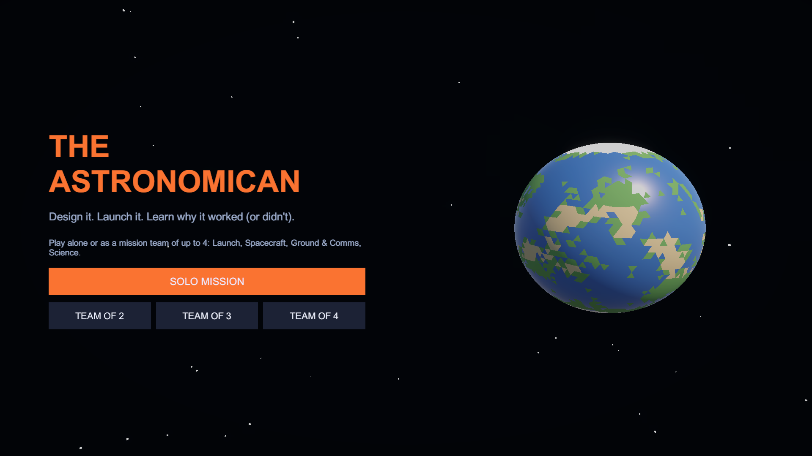
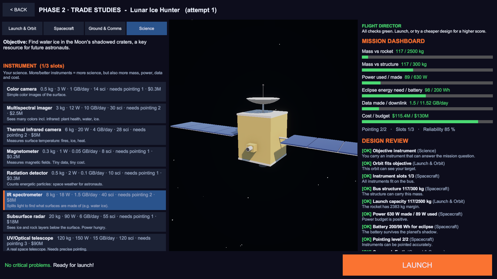
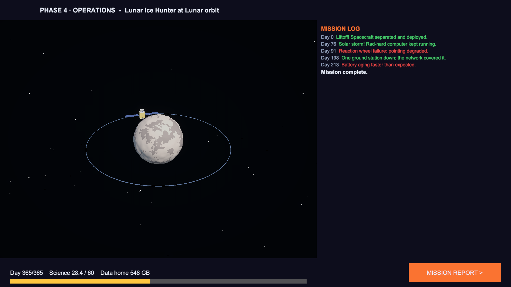
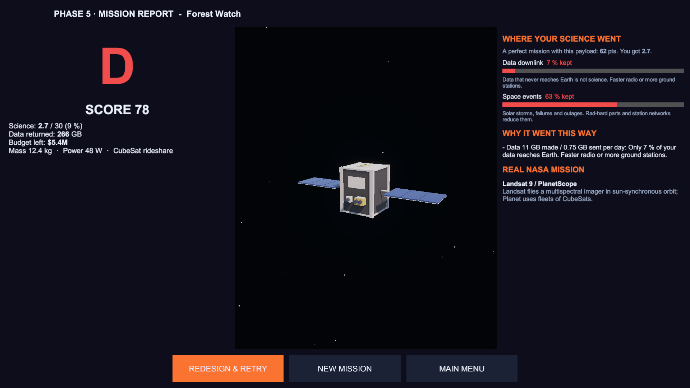

# The Astronomican: Space Mission Design Game

Built for the **NASA Space Apps Challenge 2026: [Space Mission Design Game](https://www.spaceappschallenge.org/2026/challenges/space-mission-design-game/)**.

Design a complete space mission, launch it, and learn *why* it worked (or didn't). Every choice has a consequence: a better instrument means more science, but also more mass, power, data and cost.



## ▶ Play it

| Platform | How |
|---|---|
| **Any computer, in the browser** (Windows, Mac, Linux, Chromebook) | Open **https://bakruu.github.io/The-Astronomican/**. Nothing to install. Use a desktop browser (Chrome, Edge, Firefox or Safari). |
| **Mac (download)** | Get `TheAstronomican-mac.zip` from [Releases](https://github.com/bakruu/The-Astronomican/releases), unzip, then **right-click → Open** the first time (the app is not signed by Apple, so a normal double-click is blocked). |
| **Windows / Linux (download)** | Use the browser version above, or build it yourself from the source (see *Running from source*). |

Controls: mouse only. A full mission takes about 5 minutes. A 5-step tutorial explains the screen the first time you design a spacecraft.

### Your first mission (2 minutes)

1. Click **SOLO MISSION**, then pick **Forest Watch** (easy).
2. Follow the tutorial, or press **SKIP**.
3. The **Flight Director** box (top right) always tells you what to fix next. Click its button to jump to the right tab.
4. Try this design: **Sun-synchronous** orbit, **CubeSat rideshare**, **6U CubeSat**, **Deployable panels**, **Reaction wheels**, **X-band radio**, **Multispectral imager**.
5. Press **LAUNCH**, watch the mission, then read the report. Change one thing and fly again.

| Design | Operations | Report |
|---|---|---|
|  |  |  |

## How to play

1. **Office Hours (pick a mission).** Choose an objective: *Forest Watch* (Earth observation, easy), *Lunar Ice Hunter* (medium), *Buried Ice of Mars* (hard), or *Sandbox*.
2. **Trade Studies (design).** Pick the orbit, launch vehicle, spacecraft bus, power, battery, computer, attitude control, radio, ground stations and science instruments. A live dashboard shows mass, power, eclipse energy, data downlink and budget. The design review explains every problem in plain language.
3. **Go/No-Go poll.** In team mode, every role must say GO before launch. Any design change resets the poll.
4. **Operations.** The mission is simulated over its lifetime with random events: solar storms, micrometeoroids, reaction-wheel failures, ground-station outages.
5. **Mission report.** You get a grade and score, the lessons learned, a comparison with a real NASA mission, and your attempt history. Redesign and try again.

### Solo or team (up to 4 players)

The four roles follow NASA's four mission segments:

| Role | Segment | Decides |
|---|---|---|
| Launch & Orbit | Launch segment | orbit, launch vehicle |
| Spacecraft | Space segment | bus, power, battery, computer, ADCS |
| Ground & Comms | Ground segment | radio, ground station network |
| Science | User segment | instruments, objective, budget |

The mission phases follow NASA/JPL's Mission Design Lab and Concept Maturity Levels: Office Hours → Concept → Trade Studies → Point Design.

## Running from source

- Install Unity **6000.6.9f1** (URP) with Unity Hub. Open the project and press **Play** in any scene. The game bootstraps itself, so no scene setup is needed.
- To make your own build: **File → Build Profiles**, pick Windows, Linux, Mac or Web (install the platform module in Unity Hub if it is missing), then **Build**.
- The browser version is a WebGL build in `docs/`, served by GitHub Pages (Settings → Pages → branch `main`, folder `/docs`).

## Project layout

```
Assets/_Game/
  Scripts/Data/GameDatabase.cs     all parts, orbits, launchers, scenarios (balance here)
  Scripts/Core/MissionDesign.cs    resource budgets + design review checks
  Scripts/Core/MissionSimulator.cs mission simulation, random events, scoring
  Scripts/UI/GameUI.cs             all screens (uGUI built from code)
  Scripts/View/SpacecraftView.cs   3D spacecraft / planet view
  Resources/Models/<partId>.fbx    Blender models, auto-replace placeholder primitives
Art/MissionForgeParts.blend        Blender source for the models
```

To add a model, export an FBX named after a part id (e.g. `ins_spec.fbx`) or `planet_<OrbitId>` into `Assets/_Game/Resources/Models/`.

## Data & resources

Part values are simplified but kept in realistic ranges, based on the challenge resources: NASA *CubeSat 101*, the NASA Mission Design Lab subsystem breakdown, *Design and Develop Science Missions* (launch, space, ground and user segments) and JPL Concept Maturity Levels. The real missions referenced (Landsat 9, Lunar Trailblazer, LRO, MRO/SHARAD, Hubble/JWST) are used for comparison only.
Code developed with the help of Claude Code (Anthropic)

NASA does not endorse this project.

## Team

Tunek, NASA Space Apps Challenge 2026.
